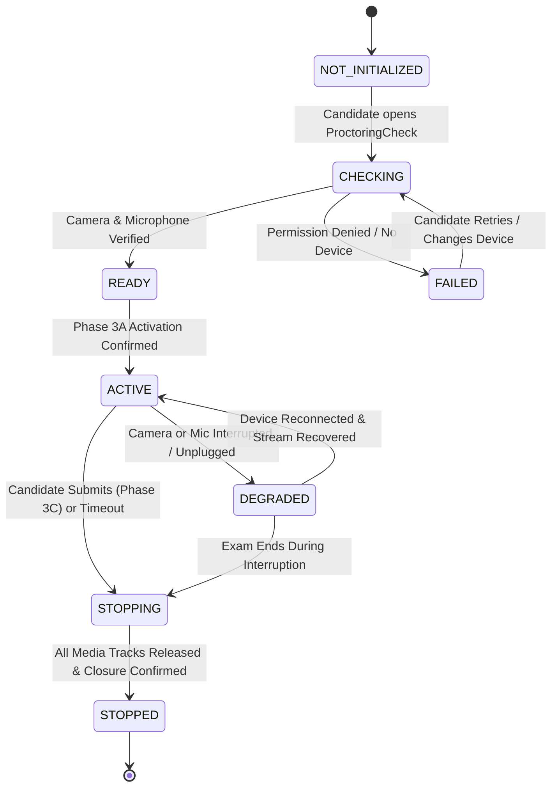

# AssessX Phase 4A Architecture Specification
## Proctoring Session Foundation

**Project:** AssessX — AI-Powered Secure Examination Platform  
**Phase:** Phase 4A of 4  
**Status:** SPECIFICATION & ARCHITECTURE  
**Platform:** Windows Desktop (Tauri + React + TypeScript + Rust) + FastAPI + PostgreSQL (Supabase)  
**Native Component:** AssessX Security Agent (`\\.\pipe\AssessXSecurityAgent`)  
**Date:** November 9, 2026

---

## 1. Executive Summary

Phase 4A establishes the foundational proctoring infrastructure for AssessX to verify, collect, and manage candidate camera and microphone device streams throughout the examination lifecycle.

Phase 4A specifically focuses on:
- Operating-system-level and webview device permission handling.
- Camera and microphone enumeration, readable labeling, and explicit candidate selection.
- Pre-examination device readiness verification (audio level testing, video stream resolution checks).
- Proctoring session lifecycle binding with Phase 3A examination activation and Phase 3C submission closure.
- Real-time device disconnection and reconnection detection.
- Privacy-first guarantees: no covert recording, no streaming to unauthorized recipients, and systematic media track release on exam finish.

**Explicitly out of scope for Phase 4A:** AI cheating detection, face recognition, gaze tracking, emotion detection, risk scoring, evidence clip storage, and WebRTC live proctor video streaming.

---

## 2. Proctoring Lifecycle State Machine

### State Definitions
1. **`NOT_INITIALIZED`**: The examination attempt exists, but proctoring device readiness has not been evaluated.
2. **`CHECKING`**: The candidate is actively granting permissions, selecting devices, or testing audio/video streams.
3. **`READY`**: Both camera and microphone have been initialized, active tracks confirmed, and the session is ready for exam entry.
4. **`ACTIVE`**: The candidate has entered the exam paper under proctoring. Device state is continuously monitored.
5. **`DEGRADED`**: A camera or microphone was disconnected, muted by OS, or captured by another application during an active exam.
6. **`STOPPING`**: The exam was submitted or reached its deadline. Media tracks are being terminated.
7. **`STOPPED`**: All media tracks are stopped, hardware indicators are off, and proctoring session is permanently marked `ENDED`.

---

## 3. Module Responsibilities

### Module A — Camera Permission & Selection
- Enumerate available video inputs via `navigator.mediaDevices.enumerateDevices()`.
- Filter `videoinput` devices, presenting human-readable labels.
- Allow candidate to select their preferred camera when multiple webcams are connected.
- Open `MediaStream` with `{ video: { deviceId: { exact: selectedId }, width: { ideal: 1280 }, height: { ideal: 720 } } }`.
- Verify video track is alive and not in `ended` state.
- Listen for `track.onended` and `navigator.mediaDevices.ondevicechange` for disconnection detection.

### Module B — Microphone Permission & Selection
- Enumerate available audio inputs via `navigator.mediaDevices.enumerateDevices()`.
- Filter `audioinput` devices, presenting human-readable labels.
- Allow candidate to select their preferred microphone.
- Open `MediaStream` with `{ audio: { deviceId: { exact: selectedId } } }`.
- Run Web Audio API `AudioContext` & `AnalyserNode` to verify live audio input levels without persisting raw audio.
- Detect microphone unplugging or revocation.

### Module C — Unified Device Readiness Service
- Combines camera, microphone, and examination proctoring policy into a single status model.
- Determines fine-grained readiness state:
  `NOT_CHECKED`, `CHECKING`, `READY`, `CAMERA_UNAVAILABLE`, `CAMERA_PERMISSION_DENIED`, `CAMERA_INITIALIZATION_FAILED`, `MICROPHONE_UNAVAILABLE`, `MICROPHONE_PERMISSION_DENIED`, `MICROPHONE_INITIALIZATION_FAILED`, `DEVICE_DISCONNECTED`, `PARTIALLY_READY`, `FAILED`.

### Module D — Session Lifecycle Orchestration
- Links proctoring session to `attempt_id`, `candidate_id`, `assessment_id`, and `authorized_device_id`.
- Reuses Phase 3A pre-flight readiness checks.
- Tears down all media capture during Phase 3C closure (`authorize_secure_examination_exit`).
- Makes all stop operations idempotent.

### Module E & F — Backend & Database Layer
- Table `proctoring_sessions` stores lifecycle state, device states, selected device identifiers, labels, readiness state, failure codes, and interruption counts.
- Endpoints:
  - `GET /api/v1/candidates/me/attempts/{attempt_id}/proctoring`: Retrieve session state.
  - `POST /api/v1/candidates/me/attempts/{attempt_id}/proctoring/activate`: Transition `NOT_STARTED` -> `ACTIVE`.
  - `POST /api/v1/candidates/me/attempts/{attempt_id}/proctoring/readiness`: Save pre-exam device readiness audit.
  - `PUT /api/v1/candidates/me/attempts/{attempt_id}/proctoring/devices`: Report device changes.
  - `POST /api/v1/candidates/me/attempts/{attempt_id}/proctoring/interruption`: Record hardware interruption events.
  - `POST /api/v1/candidates/me/attempts/{attempt_id}/proctoring/stop`: Explicit stop hook.
  - `GET /api/v1/admin/attempts/{attempt_id}/proctoring`: Admin audit view.

---

## 4. Privacy & Security Invariants
1. **No Covert Activation**: Camera and microphone are only activated on visible screens with explicit indicators.
2. **Guaranteed Release**: On component unmount, page exit, exam finish, or submission, every track's `.stop()` method is invoked immediately.
3. **No Raw Media in Logs or Databases**: Telemetry only carries device availability and hardware metadata; no audio samples or video frames are ever saved to the database.
4. **Strict Authorization**: Every request is authenticated with the candidate's session token and validated against their active attempt.

