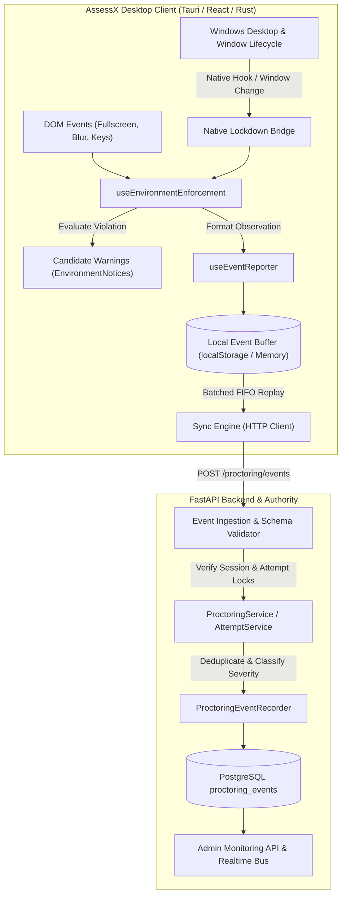

# ASSESSX — PHASE 4B ARCHITECTURE
## Exam Environment Enforcement & Event Reporting System

**Project:** AssessX — AI-Powered Secure Examination Platform  
**Phase:** 4B  
**Parent Phase:** Phase 4 — Basic Proctoring & Live Monitoring  
**Platform:** Windows 10 / Windows 11 Desktop (Tauri + React + TypeScript + Rust)  
**Backend:** FastAPI + SQLAlchemy + PostgreSQL (Supabase)  
**Status:** Approved Specification

---

## 1. System Overview

Phase 4B provides the examination environment enforcement, observation, and auditable event pipeline for AssessX.

During an active examination session, the platform monitors the client window and desktop environment, detects violations of configured examination policies (such as fullscreen departure, window minimization, or loss of application focus), issues non-accusatory guidance and candidate warnings, applies controlled automatic recovery, and persists normalized observation records to the backend for administrative oversight.

---

## 2. Core Architecture Tenets

1. **Observations, Not Verdicts:** Every event records an observable physical or software occurrence (e.g. `FULLSCREEN_EXIT`, `FOCUS_LOST`, `CAMERA_DISCONNECTED`). Events never assert candidate guilt or misconduct intent.
2. **Backend as Sole Authority:** While the desktop client generates observations, the backend validates session ownership, verifies attempt deadlines, assigns canonical server timestamps (`recorded_at`), and enforces schema immutability.
3. **Resilient Local Buffering:** If the client encounters network latency or offline disconnection, events are held in order in local storage, deduplicated by a deterministic client-generated UUID (`client_event_id`), and replayed upon reconnection with exponential backoff.
4. **Controlled Recovery Without Loops:** When fullscreen or focus is lost, recovery is attempted in a bounded, controlled manner. Uncontrolled focus loops or infinite fullscreen prompt traps are strictly prohibited.
5. **Fail-Safe Integrity:** When a security-critical boundary is compromised (e.g. Security Agent disconnected or secondary display attached), the environment transitions to a degraded state with administrator visibility preserved.

---

## 3. Component Interaction Matrix

| Layer | Component | Responsibility |
| :--- | :--- | :--- |
| **Native Rust** | `src-tauri/src/lockdown/` | Native fullscreen enforcement, always-on-top, system hook suppression, native focus tracking (`leftTo`). |
| **Native Bridge** | `bridge.ts` | Dispatches native IPC calls (`lockdown_engage`, `lockdown_restore_fullscreen`), handles fallback for browser test harness. |
| **Enforcement Hook**| `useEnvironmentEnforcement.ts`| Coordinates fullscreen state, focus tracking, clipboard & shortcut restrictions, and warning triggers. |
| **Warning UI** | `EnvironmentNotices.tsx` | Presents accessible, non-accusatory warning banners and full-screen blocking overlays. |
| **Event Pipeline** | `useEventReporter.ts` | Normalizes events, assigns UUIDs, manages offline local queues, and manages idempotent retry. |
| **Backend Validator**| `services/proctoring_events.py` | Validates strict metadata allowlists, enforces deduplication windows, maps severity, and persists records. |
| **Admin View** | `api/v1/admin_attempts.py` | Exposes event timelines and status summaries to proctors and administrators. |

