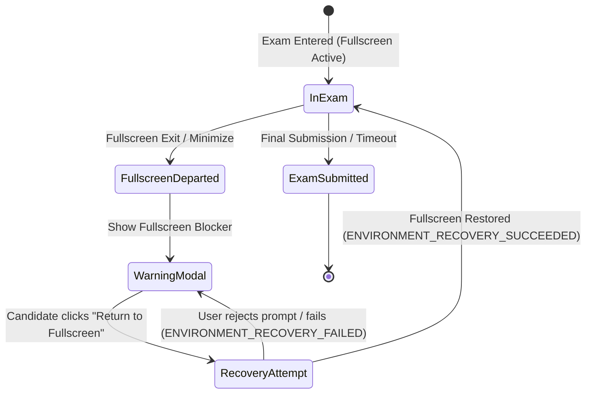

# ASSESSX — PHASE 4B ENFORCEMENT POLICY
## Fullscreen, Focus, Peripheral & Recovery Policy Matrix

**Project:** AssessX — AI-Powered Secure Examination Platform  
**Phase:** 4B  
**Parent Phase:** Phase 4 — Basic Proctoring & Live Monitoring  
**Status:** Approved Specification

---

## 1. Fullscreen Policy Modes

Each assessment configuration may define one of three fullscreen enforcement policies:

| Policy Mode | Fullscreen Required | Exit Allowed | Recovery Mechanism | Violation Action |
| :--- | :--- | :--- | :--- | :--- |
| **REQUIRED** (Default) | Yes | No | Fullscreen blocker dialog; single-click return. | Disables exam view until fullscreen restored. Clock continues. |
| **OPTIONAL** | No | Yes | Informational toast notice; no modal blocking. | Event logged; candidate continues unblocked. |
| **DISABLED** | No | Yes | No enforcement or notifications. | No events logged. |

---

## 2. Recovery Protocols



### 2.1 Controlled Auto-Restore
- When an examination window regains focus after an accidental blur (e.g. system notification dismissal), an automatic fullscreen restoration is attempted **once** (`autoRestoreArmed = false`).
- If the browser or operating system rejects the programmatic restore, the application does not loop; instead, it presents an accessible modal button requiring an explicit user gesture.

### 2.2 Candidate Warning Presentation
All candidate warnings are formulated according to the AssessX Communication Standard:
- **Objective & Fact-Based:** Describe what occurred without accusatory language.
- **Action-Oriented:** Tell the candidate how to resolve the issue immediately.
- **Time-Aware:** Remind the candidate that the examination clock continues running during interruptions.

```markdown
> [!WARNING]
> "You have exited fullscreen mode. Please return to fullscreen to continue your assessment. Your answers are saved and the clock is still running."
```

