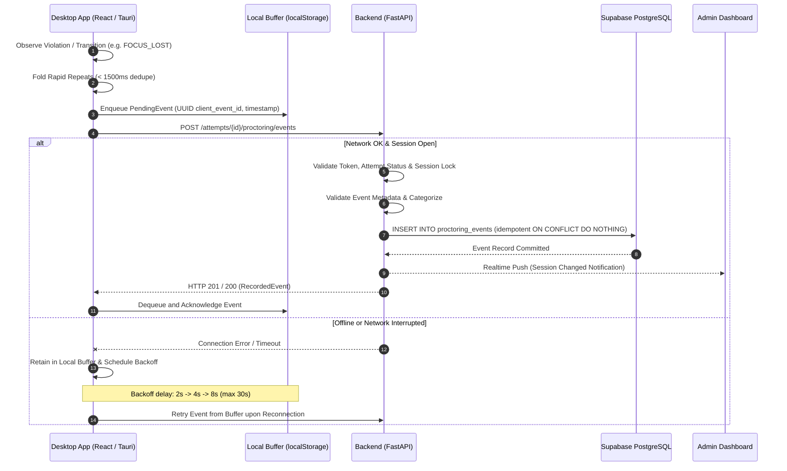

# ASSESSX — PHASE 4B EVENT PIPELINE
## End-to-End Event Ingestion, Local Buffering & Synchronization Specification

**Project:** AssessX — AI-Powered Secure Examination Platform  
**Phase:** 4B  
**Parent Phase:** Phase 4 — Basic Proctoring & Live Monitoring  
**Status:** Approved Specification

---

## 1. Event Ingestion Lifecycle

---

## 2. Ingestion & Synchronization Rules

### 2.1 Deduplication & Idempotency
- **Client Folding:** Identical events of the same `event_type` and metadata within `1500ms` are collapsed into a single observation to prevent burst spam (e.g., holding `Ctrl+V` down).
- **Server Deduplication:** Database enforces `UNIQUE(session_id, client_event_id)`. Re-sending an event that was previously acknowledged will return the original record with HTTP 200 instead of inserting a duplicate row.
- **Dedupe Window:** Server-side `DEDUPE_WINDOW` of 1 second folds identical observations occurring in quick succession.

### 2.2 Local Queue Durability
- Pending events are held in `localStorage` under `assessx.proctoring-events.{attempt_id}` bounded to 200 entries.
- If storage is restricted or disabled, events remain buffered in-memory for the lifetime of the desktop window.
- The queue is drained sequentially (FIFO) to preserve relative temporal causality.

### 2.3 Autorun & Termination Handling
- Once the attempt is locked (`SUBMITTED` or `TIME_EXPIRED`), the backend rejects new events with `attempt_locked` (HTTP 409).
- When `attempt_locked` or `event_limit_reached` is received, the client halts retry loops and discards obsolete queue entries cleanly.

