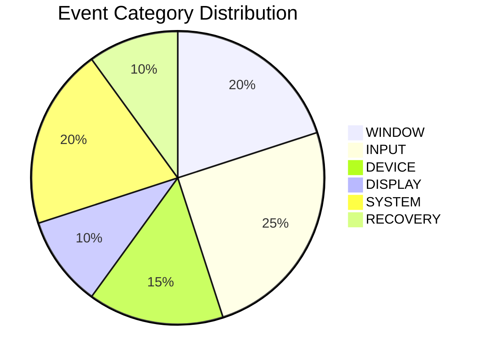

# ASSESSX — PHASE 4B EVENT TAXONOMY
## Unified Event Classification & Metadata Specification

**Project:** AssessX — AI-Powered Secure Examination Platform  
**Phase:** 4B  
**Parent Phase:** Phase 4 — Basic Proctoring & Live Monitoring  
**Status:** Approved Specification

---

## 1. Classification Categories

Every proctoring event belongs to a canonical category derived server-side from its `event_type`:

1. **WINDOW:** Window state transitions, fullscreen changes, minimization, focus departure and restoration.
2. **INPUT:** Keystroke attempts, clipboard access, context menus, developer tool launches, and print requests.
3. **DEVICE:** Multimedia hardware interruptions, disconnections, reconnects, or initialization failures.
4. **DISPLAY:** Changes in display topology, external monitors, or screen configuration.
5. **SYSTEM:** Security Agent connectivity, process policy violations, remote desktop detection, and kiosk health.
6. **RECOVERY:** Structured recovery workflows (attempted, succeeded, or failed).

---

## 2. Comprehensive Event Catalog

| Event Type | Category | Severity | Origin | Description | Accepted Metadata |
| :--- | :--- | :--- | :--- | :--- | :--- |
| `FULLSCREEN_ENTER` | `WINDOW` | `INFO` | Client | Fullscreen mode successfully entered. | `reason` |
| `FULLSCREEN_EXIT` | `WINDOW` | `MEDIUM` | Client | Window left fullscreen mode. | `previous_state`, `current_state`, `reason` |
| `FULLSCREEN_RESTORED` | `WINDOW` | `INFO` | Client | Fullscreen recovered after departure. | `reason` |
| `FULLSCREEN_REQUEST_FAILED`| `WINDOW` | `MEDIUM` | Client | Fullscreen request was rejected by OS or user. | `reason` |
| `FOCUS_LOST` | `WINDOW` | `LOW` | Client | Examination window lost foreground focus. | `reason`, `left_to` |
| `FOCUS_REGAINED` | `WINDOW` | `INFO` | Client | Window returned to foreground focus. | `duration_ms`, `left_to` |
| `WINDOW_MINIMIZED` | `WINDOW` | `MEDIUM` | Client | Examination window minimized to taskbar. | `reason`, `left_to` |
| `WINDOW_RESTORED` | `WINDOW` | `INFO` | Client | Minimized examination window un-minimized. | `duration_ms` |
| `EXAM_CLOSE_ATTEMPT` | `WINDOW` | `HIGH` | Client | Candidate attempted Alt+F4 or window close. | `blocked` |
| `COPY_ATTEMPT` | `INPUT` | `LOW` | Client | Copy operation blocked. | `shortcut`, `blocked`, `channel` |
| `PASTE_ATTEMPT` | `INPUT` | `LOW` | Client | Paste operation blocked. | `shortcut`, `blocked`, `channel` |
| `CUT_ATTEMPT` | `INPUT` | `LOW` | Client | Cut operation blocked. | `shortcut`, `blocked`, `channel` |
| `CLIPBOARD_ACCESS_ATTEMPT` | `INPUT` | `LOW` | Client | Direct clipboard read/write attempt. | `shortcut`, `blocked`, `channel` |
| `CONTEXT_MENU_ATTEMPT` | `INPUT` | `INFO` | Client | Right-click context menu blocked. | `blocked`, `channel` |
| `PRINT_ATTEMPT` | `INPUT` | `MEDIUM` | Client | Print dialogue request suppressed. | `shortcut`, `blocked`, `channel` |
| `DEVTOOLS_ATTEMPT` | `INPUT` | `HIGH` | Client | F12 / Inspect shortcut blocked. | `shortcut`, `blocked`, `channel` |
| `KEYBOARD_RESTRICTION_ATTEMPT` | `INPUT` | `MEDIUM` | Client | Windows / Alt+Tab shortcut intercepted. | `shortcut`, `blocked`, `channel` |
| `SCREEN_CAPTURE_ATTEMPT` | `INPUT` | `HIGH` | Client | PrintScreen / Snipping Tool intercepted. | `shortcut`, `blocked`, `channel` |
| `CAMERA_DISCONNECTED` | `DEVICE` | `HIGH` | Server/Client | Primary webcam lost or unplugged. | `state`, `reason` |
| `CAMERA_RECONNECTED` | `DEVICE` | `INFO` | Server/Client | Primary webcam re-acquired. | `state` |
| `MIC_DISCONNECTED` | `DEVICE` | `HIGH` | Server/Client | Audio input device lost or unplugged. | `state`, `reason` |
| `MIC_RECONNECTED` | `DEVICE` | `INFO` | Server/Client | Audio input device re-acquired. | `state` |
| `MEDIA_INITIALIZATION_FAILED` | `DEVICE` | `HIGH` | Client | Hardware stream could not be opened. | `device_type`, `reason` |
| `MULTIPLE_MONITORS_DETECTED` | `DISPLAY` | `HIGH` | Client | Secondary monitor attached or detected. | `display_count` |
| `DISPLAY_CONFIGURATION_CHANGED` | `DISPLAY` | `MEDIUM` | Client | Resolution or monitor topology changed. | `display_count`, `previous_display_count` |
| `REMOTE_SESSION_DETECTED` | `SYSTEM` | `CRITICAL` | Client | RDP / VNC / Virtual session active. | `environment` |
| `ENFORCEMENT_STATUS` | `SYSTEM` | `INFO` | Client | Diagnostic dump of active client guards. | `capabilities`, `environment`, `security_mode` |
| `SECURITY_AGENT_DISCONNECTED` | `SYSTEM` | `CRITICAL` | Client/Server | Windows Agent pipe broken or dead. | `reason` |
| `SECURITY_AGENT_RECONNECTED` | `SYSTEM` | `INFO` | Client/Server | Windows Agent pipe reconnected. | `agent_version` |
| `RESTRICTED_APPLICATION_DETECTED` | `SYSTEM` | `HIGH` | Client | Prohibited process running or spawned. | `app`, `app_category` |
| `POLICY_ENFORCEMENT_FAILURE` | `SYSTEM` | `HIGH` | Client | Failure in kiosk, shell, or hook guard. | `guard_name`, `error_code` |
| `ENVIRONMENT_RECOVERY_STARTED` | `RECOVERY` | `INFO` | Client | Automatic or user recovery initiated. | `target_state`, `trigger_event` |
| `ENVIRONMENT_RECOVERY_SUCCEEDED` | `RECOVERY` | `INFO` | Client | Fullscreen or focus successfully restored.| `target_state`, `duration_ms` |
| `ENVIRONMENT_RECOVERY_FAILED` | `RECOVERY` | `HIGH` | Client | Recovery attempt failed or timed out. | `target_state`, `reason` |

---

## 3. Strict Metadata Validation Principles

- **No Arbitrary Fields:** Any property not explicitly registered in `_TYPE_FIELDS` triggers an HTTP 422 `ValidationFailed`.
- **No Raw Data:** Passwords, keystrokes, clipboard text, exam answers, file paths, or private personal information are strictly forbidden from event payloads.
- **Enumerated Substrings:** Only validated application tokens matching `^[a-z0-9][a-z0-9._-]{0,39}$` and shortcut tokens matching `^[A-Z0-9]{1,12}(\+[A-Z0-9]{1,12}){0,4}$` are permitted.

