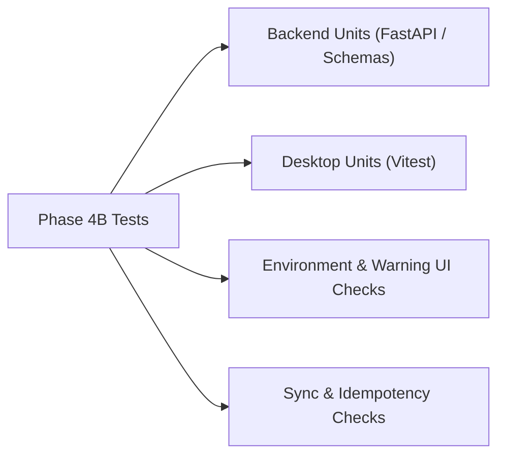

# ASSESSX — PHASE 4B TEST PLAN
## Verification Strategy & Test Cases

**Project:** AssessX — AI-Powered Secure Examination Platform  
**Phase:** 4B  
**Parent Phase:** Phase 4 — Basic Proctoring & Live Monitoring  
**Status:** Approved Specification

---

## 1. Test Matrix

---

## 2. Test Cases

### 2.1 Backend Unit Tests (`backend/tests/test_proctoring_events_foundation.py`)
- **T1: Event Type and Category Serialization:** Verify newly mapped event types (`WINDOW_MINIMIZED`, `WINDOW_RESTORED`, `FULLSCREEN_REQUEST_FAILED`, `SECURITY_AGENT_DISCONNECTED`, `ENVIRONMENT_RECOVERY_STARTED`, etc.) resolve to their canonical categories.
- **T2: Metadata Validation Allowlist:** Test that valid payloads pass and invalid / unknown metadata fields are strictly rejected with HTTP 422.
- **T3: Severity Determination:** Verify deterministic mapping of event types to `INFO`, `LOW`, `MEDIUM`, `HIGH`, or `CRITICAL` severity levels.
- **T4: Event Ingestion Scoping:** Verify candidate cannot report events on unowned or locked attempts.
- **T5: Event Idempotency:** Verify submitting the same `client_event_id` returns HTTP 200 with the original event without duplicating records.
- **T6: Admin Events Query:** Test admin query filtering by category, severity, limit, and offset.

### 2.2 Desktop Unit Tests (`apps/desktop/src/features/proctoring/__tests__/environmentEnforcement.test.ts`)
- **T7: Fullscreen Departure Detection:** Verify transition from fullscreen to windowed/minimized emits `FULLSCREEN_EXIT` and triggers warning flag.
- **T8: Focus Loss & Duration Tracking:** Verify blur triggers `FOCUS_LOST`, subsequent focus triggers `FOCUS_REGAINED` with computed `duration_ms`.
- **T9: Controlled Recovery Loop Prevention:** Verify `autoRestoreArmed` allows only a single programmatic restore attempt per focus return.
- **T10: Local Queue Deduplication:** Verify `useEventReporter` folds identical events occurring within 1500ms into a single entry.
- **T11: Offline Queue Persistence:** Verify events remain stored in `localStorage` when network fails and drain sequentially upon flush.
- **T12: Candidate Warning Deduplication:** Verify duplicate warnings within 3000ms do not stack multiple banner elements.

