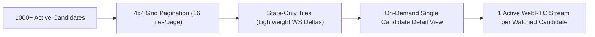

# ASSESSX — PHASE 4C SCALABILITY
## Grid Pagination, Targeted Updates & Resource Management

**Project:** AssessX — AI-Powered Secure Examination Platform  
**Phase:** 4C  
**Status:** Approved Specification

---

## 1. Scalability Architecture

- **Controlled Grid Viewport (`PAGE_SIZE = 16`):** The 4×4 monitoring wall paginates active sessions so large cohorts never overwhelm browser rendering or DOM state.
- **State-Only Tiles:** Grid cards display device status, presence, and summary indicators without initializing 16 concurrent WebRTC video decoders.
- **On-Demand Video & Bitrate Caps:** Peer connections are created exclusively when an administrator inspects a candidate (`CandidateDetailView`), and candidate video senders clamp resolution and uplink bitrate via `limitLiveVideo()`.
- **Targeted WebSocket Deltas:** `SESSION_UPDATED`, `SESSION_REMOVED`, and `PROCTORING_EVENT` deltas push incremental updates rather than broadcasting the entire session list on every change.
- **Fallback Reconciliation:** If the WebSocket disconnects, `useMonitoring` polls REST every `5000ms` (`FALLBACK_POLL_MS`) with bounded exponential reconnection backoff (`500ms` → `8000ms`), guaranteeing eventual consistency without tight loops.

