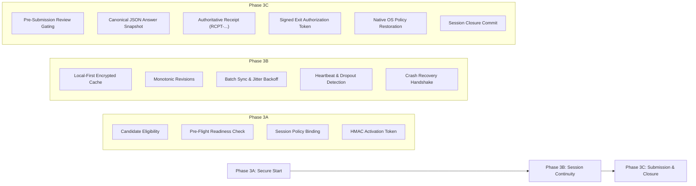

# AssessX Phase 3 Milestone Summary
## Complete Examination Authorization & Lifecycle Security

**Project:** AssessX — AI-Powered Secure Examination Platform  
**Phase:** Phase 3 of 4 (Complete)  
**Subphases:**
- **Phase 3A:** Examination Activation, Candidate Verification & Secure Start Authorization
- **Phase 3B:** Examination Session Continuity, Answer Persistence & Recovery
- **Phase 3C:** Secure Examination Submission, Exit Authorization & Examination Closure
**Platform:** Windows 10 & 11 (Tauri + React + Rust) + FastAPI + PostgreSQL (Supabase)  
**Native Component:** AssessX Security Agent (`\\.\pipe\AssessXSecurityAgent`)  
**Status:** COMPLETED & VERIFIED  
**Date:** November 9, 2026

---

## 1. Overview of Phase 3 Subphases

---

## 2. Milestone Deliverables Summary

| Subphase | Core Capability | Key Deliverables | Verification Status |
| :--- | :--- | :--- | :--- |
| **Phase 3A** | Examination Activation & Start Authorization | `session_activation` Rust module, pre-flight readiness evaluator (`PreFlightReadinessModal.tsx`), session policy binding, HMAC-SHA256 activation tokens, `/authorizations/` backend endpoints. | **100% Passed** (7/7 backend unit tests, 3/3 frontend unit tests) |
| **Phase 3B** | Examination Session Continuity & Recovery | `session_continuity` Rust encrypted persistence, `SessionSyncManager` queue draining, heartbeat emitter & dropout monitor (`SessionContinuityCard.tsx`), crash recovery controller. | **100% Passed** (6/6 backend unit tests, 4/4 frontend unit tests) |
| **Phase 3C** | Examination Submission, Exit Auth & Closure | `SubmissionReviewModal.tsx`, canonical SHA-256 snapshot hashing, `SubmissionReceiptCard.tsx`, signed exit authorization tokens, native OS policy rollback orchestration (`authorize_secure_examination_exit`), `AdminSubmissionClosureCard.tsx`. | **100% Passed** (6/6 backend unit tests, 6/6 frontend unit tests, 1/1 cargo test) |

---

## 3. Verification Across All Phase 3 Subsystems

- **Frontend (Tauri / React / TypeScript)**:
  - 30 test suites passed (308 unit tests).
  - TypeScript compiler (`tsc -b`): Clean with 0 errors.
  - Oxlint linter: Clean with 0 errors across 358 files.
- **Backend (FastAPI / SQLAlchemy / Pydantic)**:
  - All 19 Phase 3 unit tests passed (`7 Phase 3A + 6 Phase 3B + 6 Phase 3C`).
  - Ruff linter: Clean with 0 errors across all Phase 3 endpoints, schemas, and services.
- **Native Security Layer (Rust)**:
  - Native Tauri module builds cleanly with 0 errors.
  - IPC handler for `AuthorizeExitAndRestore` fully wired to revert navigation, system utilities, AppLocker allowlists, and peripherals.

