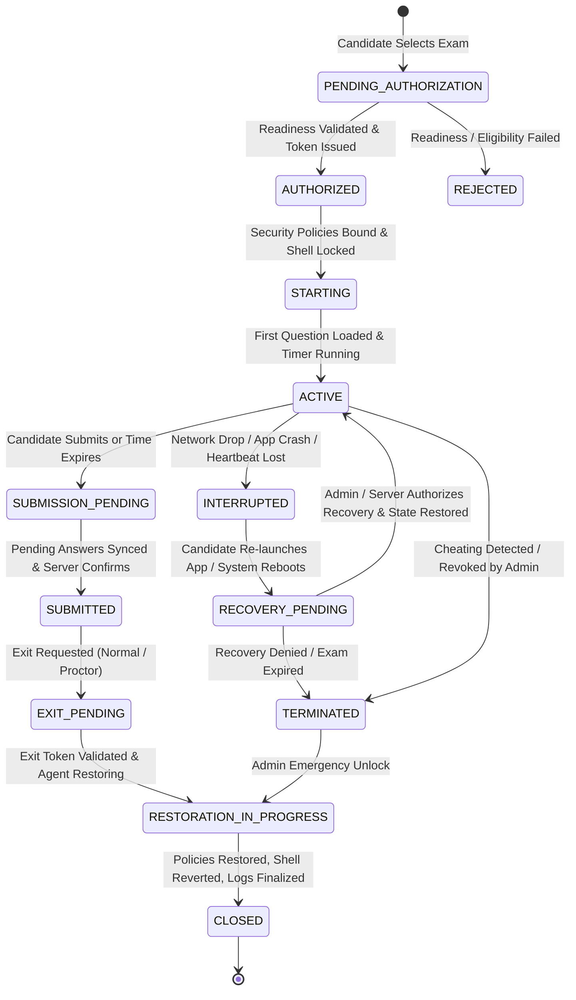

# ASSESSX — PHASE 3 KNOWLEDGE BASE
## Examination Authorization, Lifecycle Security & Institutional Administration

**Project:** AssessX  
**Phase:** 3 of 4  
**Phase Name:** Examination Authorization & Lifecycle Security  
**Subphases:** 
- **Phase 3A:** Examination Activation & Start Authorization
- **Phase 3B:** Session Continuity, Answer Persistence & Recovery
- **Phase 3C:** Secure Exit, Completion & Institutional Administration  
**Target Platform:** Windows 10 / Windows 11 (Home, Pro, Enterprise, Education)  
**Desktop Stack:** Tauri v2 + React 19 + TypeScript + Rust (windows-sys)  
**Native Agent:** Rust AssessX Security Agent (Named Pipe IPC `\\.\pipe\AssessXSecurityAgent`)  
**Backend:** FastAPI + Python 3.11 + Pydantic v2 + SQLAlchemy  
**Database:** PostgreSQL (Supabase)  
**Document Type:** Master Technical Specification & Architecture Knowledge Base  
**Status:** Approved Specification / Implementation Ready  

---

## 1. Executive Summary & Purpose

Phase 1 established the core Windows foundation:
- **Phase 1A:** Device provisioning, compatibility validation, and candidate user profile configuration.
- **Phase 1B:** Secure kiosk/shell initialization, desktop application lifecycle management, and clean restoration.
- **Phase 1C:** Native Security Agent running as a high-integrity background service communicating via authenticated Named Pipe IPC.

Phase 2 fortified the operating system with kernel- and OS-level restrictions:
- **Phase 2A:** Application execution allowlisting (AppLocker / Windows Defender Application Control / Process Monitor fallback).
- **Phase 2B:** PowerShell, Command Prompt, Task Manager, Registry Tools, and System Utility access restrictions.
- **Phase 2C:** Low-level keyboard hook restrictions (`WH_KEYBOARD_LL`), Windows navigation suppression (Start menu, taskbar, Alt+Tab, Task View, Action Center), and multi-monitor hotkey lockdowns.
- **Phase 2D:** USB removable mass storage blocking (`Deny_All`), virtual/multi-display inspection (`SM_CMONITORS`), peripheral verification, and 14-tool remote access detection (`SM_REMOTESESSION`, RDP, AnyDesk, TeamViewer, RustDesk, etc.).

**Phase 3** introduces the end-to-end **Examination Authorization, Lifecycle Management & Institutional Administration Layer**. It connects the native security controls of Phase 1 and 2 to real-world academic examination workflows.

The primary mission of Phase 3 is:
1. **Prevent Unauthorized Starts:** An examination cannot start simply because the app is launched. It requires verified candidate eligibility, approved device registration, scheduled window validation, and full native security readiness.
2. **Guarantee Session Continuity & Zero Data Loss:** Candidate answers are saved continuously, locally buffered with encryption during network dropouts, synchronized with revision tracking, and recoverable across crashes or reboots without compromising exam integrity.
3. **Enforce Authorized Exit & Clean Restoration:** A candidate cannot exit the secure environment without submitting or obtaining authorized proctor approval. Exiting initiates a verified, multi-step restoration of the candidate's Windows environment back to its original state.
4. **Institutional Central Management:** University and organizational administrators centrally configure exams, monitor live candidates in real time, distribute cryptographically signed security policies, handle recovery requests, and inspect audit logs.

---

## 2. Core Architectural Principles

1. **Backend Authority:** The backend is the single source of truth for candidate eligibility, schedules, activation tokens, session states, and submissions. The desktop application never self-authorizes.
2. **Extend Existing Architecture:** Reuses existing FastAPI schemas, PostgreSQL models, React features, Tauri commands, and the Rust Security Agent. No duplicate agents or conflicting session frameworks.
3. **Defense-in-Depth:** Frontend checks are backed by desktop Rust validation, which in turn is validated by the background Security Agent and verified by backend cryptographic tokens.
4. **Zero Data Loss Guarantee:** Every keystroke and selection is debounced, persisted locally to encrypted storage, and acknowledged by the server using monotonic client-server revision numbers.
5. **Fail-Safe & Recoverable:** Network drops, app crashes, or power cuts place the session in `INTERRUPTED` or `RECOVERY_PENDING` state. Recovery requires backend cryptographic re-authorization.
6. **Non-Destructive by Default:** All native restrictions remain in Audit/Non-Destructive mode during development and testing, enforcing strict rollback guarantees.

---

## 3. Subphase Overview & Architecture Matrix

| Subphase | Primary Domain | Core Deliverables | Native / Backend Integration |
|---|---|---|---|
| **Phase 3A** | Examination Activation & Start Authorization | Candidate eligibility check, device registration verification, security readiness scanner, short-lived activation tokens, session state machine initialization | Named Pipe IPC readiness scan, FastAPI `/api/v1/examinations/...`, Pydantic models, Supabase `examination_sessions` |
| **Phase 3B** | Session Continuity & Answer Persistence | Continuous answer autosave, monotonic revision tracking, local encrypted SQLite/DPAPI buffer, periodic heartbeats, crash & network recovery engine | Rust local storage engine, background sync worker, FastAPI `/api/v1/sessions/.../answers`, Supabase `session_answers` |
| **Phase 3C** | Secure Exit, Completion & Administration | Final submission validation, proctor/admin exit authorization, Security Agent shell restoration, institutional admin dashboard, remote policy distribution | Rust shell restorer, FastAPI `/api/v1/sessions/.../submit`, `/policies`, React Admin Dashboard, Supabase `audit_logs` |

---

## 4. Complete Examination Lifecycle State Machine

---

## 5. Security Agent Named Pipe IPC Additions

To support Phase 3 lifecycle and authorization operations, the Named Pipe IPC protocol (`\\.\pipe\AssessXSecurityAgent`) is extended with the following message types:

1. `ValidateReadiness`: Scans all Phase 1 and Phase 2 restrictions (shell, allowlist, utilities, navigation, storage, monitors, remote tools) and returns structured status.
2. `BindSessionPolicy`: Links the active examination session ID and authorized security policy to the agent runtime.
3. `ReportSessionHeartbeat`: Passes heartbeats containing process integrity metrics and violation counts to the agent for tamper cross-checks.
4. `AuthorizeSessionExit`: Receives a signed exit authorization token from the desktop client to trigger atomic system restoration.
5. `RestoreSystemState`: Reverts registry overrides, releases keyboard hooks, resets USB policies, and restores explorer shell if configured.

---

## 6. Institutional Policy & Administration Architecture

Institutional administrators control exam parameters via the unified Admin Dashboard:
- **Exam Configuration:** Duration, grace periods, prohibited tools, peripheral rules, and offline continuation policies.
- **Device Management:** Whitelisting laboratory devices, inspecting hardware IDs, and approving/revoking endpoints.
- **Live Proctoring & Monitoring:** Live candidate status, answer synchronization metrics, network latency, and suspicious event alerts.
- **Recovery Authorization:** Reviewing crashed/interrupted sessions and approving one-click cryptographic resume tokens.
- **Remote Policy Dispatch:** Drafting, digitally signing, publishing, and rolling back security policy packages.

---

## 7. Documentation Index

The complete Phase 3 engineering specification is broken down into three detailed subphase documents:
1. [Phase 3A — Examination Activation & Start Authorization](file:///D:/AssessX-AI/AssessX-AI-main/docs/phases/PHASE-3A-EXAMINATION-ACTIVATION-AND-START-AUTHORIZATION.md)
2. [Phase 3B — Session Continuity, Answer Persistence & Recovery](file:///D:/AssessX-AI/AssessX-AI-main/docs/phases/PHASE-3B-SESSION-CONTINUITY-ANSWER-PERSISTENCE-AND-RECOVERY.md)
3. [Phase 3C — Secure Exit, Completion & Institutional Administration](file:///D:/AssessX-AI/AssessX-AI-main/docs/phases/PHASE-3C-SECURE-EXIT-COMPLETION-AND-INSTITUTIONAL-ADMINISTRATION.md)

