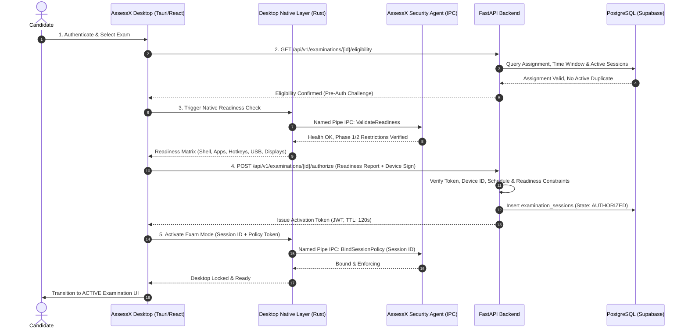

# ASSESSX — PHASE 3A SPECIFICATION
## Examination Activation & Start Authorization

**Project:** AssessX  
**Subphase:** Phase 3A of 4  
**Title:** Examination Activation & Start Authorization  
**Parent Document:** [Phase 3 Knowledge Base](file:///D:/AssessX-AI/AssessX-AI-main/docs/phases/PHASE-3-KNOWLEDGE-BASE.md)  
**Target Platform:** Windows 10 / Windows 11  
**Desktop Stack:** Tauri v2 + React 19 + TypeScript + Rust  
**Native Agent:** AssessX Security Agent (Rust, Named Pipe IPC `\\.\pipe\AssessXSecurityAgent`)  
**Backend:** FastAPI + SQLAlchemy + PostgreSQL (Supabase)  
**Document Type:** Detailed Engineering & Implementation Specification  
**Status:** Implementation Ready  

---

## 1. Objectives & Overview

Phase 3A implements the pre-flight authorization and activation engine that governs entry into an examination.

### Key Goals:
1. **Prevent Unverified Starts:** Ensure an examination cannot start simply by launching the desktop application or navigating to an assessment URL.
2. **Multi-Factor Pre-Flight Validation:** Verify candidate authentication, exam assignment, schedule window, device registration, and native Windows security readiness before issuing an activation token.
3. **Hardware & OS Integrity Check:** Verify that the Security Agent is active, Phase 1 shell readiness is verified, and Phase 2 restrictions (apps, utilities, hotkeys, peripherals, remote tools) are operational.
4. **Cryptographically Protected Session Creation:** Generate a unique, short-lived session token tied to the candidate, examination, device, and institutional policy version.
5. **Session Lock & State Transition:** Atomically advance the examination session from `PENDING_AUTHORIZATION` to `AUTHORIZED` and `STARTING`.

---

## 2. Authorization & Readiness Architecture



---

## 3. Pre-Examination Readiness Check Matrix

Before the backend will issue an activation token, the desktop application runs a comprehensive readiness evaluation. Each check returns one of five standard statuses:
- `READY`: Condition fully satisfied.
- `WARNING`: Minor non-blocking issue (e.g., single monitor detected, low battery warning).
- `NOT_READY`: Remediation required before proceeding (e.g., dual monitors detected, banned app running).
- `UNSUPPORTED`: Feature not available on current Windows edition/hardware.
- `VERIFICATION_FAILED`: Security check failed cryptographically or agent unreachable.

### Detailed Check Specifications:

| Category | Check Identifier | Verification Mechanism | Blocking / Severity |
|---|---|---|---|
| **Identity & Account** | `candidate_auth` | Valid JWT bearer token with student role | `NOT_READY` (Blocks) |
| **Exam Eligibility** | `candidate_assignment` | Backend check: candidate assigned to exam ID | `NOT_READY` (Blocks) |
| **Exam Schedule** | `schedule_window` | Current server time between `start_time` and `end_time` | `NOT_READY` (Blocks) |
| **Duplicate Session** | `single_session_lock` | No existing session in `ACTIVE` or `STARTING` state | `NOT_READY` (Blocks) |
| **Device Registration** | `device_enrolled` | Device hardware ID registered and approved in institution | `NOT_READY` (Blocks) |
| **Security Agent** | `agent_health` | Named Pipe ping & version check (`AssessXSecurityAgent`) | `NOT_READY` (Blocks) |
| **Secure Shell** | `shell_provisioning` | Desktop running in primary shell / kiosk mode | `WARNING` (Policy Dependent) |
| **App Execution** | `allowlist_enforcement`| WDAC / AppLocker active or Process Monitor running | `NOT_READY` (Blocks) |
| **System Utilities** | `utility_restrictions` | Reg policies for TaskMgr, CMD, PowerShell, Registry verified | `NOT_READY` (Blocks) |
| **Keyboard / Nav** | `hotkey_hook_active` | Low-level keyboard hook installed (`WH_KEYBOARD_LL`) | `NOT_READY` (Blocks) |
| **Display Topology** | `single_monitor_check` | `SM_CMONITORS == 1` & no virtual display adapters | `NOT_READY` (Blocks) |
| **Peripheral Storage** | `usb_storage_blocked` | `RemovableStorageDevices\Deny_All` verified | `NOT_READY` (Blocks) |
| **Remote Access** | `remote_tool_scanner` | 0 active remote tools (AnyDesk, TeamViewer, RDP) | `NOT_READY` (Blocks) |
| **Hardware Devices** | `webcam_mic_ready` | Camera & microphone operational (if proctored exam) | `NOT_READY` (Blocks) |
| **Network Quality** | `backend_latency` | RTT to backend `< 1500ms`, packet loss `< 5%` | `WARNING` (Advisory) |

---

## 4. Activation Token & Session Security

1. **Short-Lived Activation Tokens:**
   - Tokens issued upon successful readiness evaluation have a strict **120-second Time-To-Live (TTL)**.
   - If the candidate does not successfully enter the exam within 120 seconds, the activation expires and readiness must be re-validated.
2. **Cryptographic Binding:**
   - The token contains: `session_id`, `candidate_id`, `exam_id`, `device_id`, `institution_id`, `policy_version`, and `issued_at`.
   - Signed using server private key (RS256 or HS256 secret) and validated by backend endpoints on all subsequent requests.
3. **Replay Protection:**
   - Each token contains a unique `jti` (JWT ID). Once the session transitions to `ACTIVE`, the token cannot be reused to spawn a secondary session.
4. **Agent Policy Binding:**
   - The desktop client passes the `session_id` and signed policy checksum to the Security Agent via Named Pipe IPC (`BindSessionPolicy`).
   - The Security Agent locks the policy version and associates all subsequent OS audit logs with this `session_id`.

---

## 5. Session State Transitions (Phase 3A Focus)

```
[Candidate Selects Exam]
           │
           ▼
  PENDING_AUTHORIZATION  ───(Readiness Failed)───►  REJECTED
           │
     (Readiness OK)
           │
           ▼
       AUTHORIZED
           │
  (Desktop Locks Shell & Hooks)
           │
           ▼
        STARTING
           │
  (First Question Loaded)
           │
           ▼
         ACTIVE
```

- **Validation Rule:** State transitions must be validated on the backend. The client cannot send `state: "ACTIVE"` directly; it requests `POST /api/v1/sessions/{id}/start` with client telemetry, and the server validates prerequisites before returning the `ACTIVE` status.

---

## 6. Frontend User Interface Components

Phase 3A introduces modern, accessible, and high-visibility UI components in `apps/desktop/src/features/exam/`:

1. **`ExamSelectionList.tsx`**:
   - Displays scheduled, available, and completed exams for the candidate.
   - Shows badge indicators: "Ready to Start", "Starts in 15 mins", "Expired", or "Attempt Used".
2. **`PreFlightReadinessModal.tsx`**:
   - Automated checklist executing checks sequentially with animated progress indicators:
     - Identity & Exam Assignment [Check]
     - Device Registration [Check]
     - Native Security Agent [Check]
     - Display & Peripheral Inspection [Check]
     - Network & Latency Check [Check]
   - Shows actionable remediation guidance if a check fails (e.g., "Disconnect external monitor HDMI-2 to continue").
3. **`ExamAuthorizationScreen.tsx`**:
   - Examination title, duration, total marks, institutional honor code, and allowed reference materials.
   - "Enter Secure Examination" button (disabled until readiness is 100% satisfied).
4. **`ActivationLoader.tsx`**:
   - Fullscreen modal displayed during the 1-2 second transition while the desktop native layer locks hooks, binds policies with the Security Agent, and loads questions.

---

## 7. Backend API Specifications

### 7.1 Check Eligibility
- **Endpoint:** `GET /api/v1/examinations/{exam_id}/eligibility`
- **Headers:** `Authorization: Bearer <token>`, `X-Device-Id: <hw_id>`
- **Response:**
```json
{
  "eligible": true,
  "exam_id": "exam_uuid",
  "candidate_id": "user_uuid",
  "attempt_number": 1,
  "max_attempts": 1,
  "window_start": "2026-11-09T09:00:00Z",
  "window_end": "2026-11-09T17:00:00Z",
  "device_registered": true,
  "existing_session_id": null
}
```

### 7.2 Submit Readiness & Request Authorization
- **Endpoint:** `POST /api/v1/examinations/{exam_id}/authorize`
- **Request Body:**
```json
{
  "device_id": "device_hw_uuid",
  "agent_version": "1.2.0",
  "readiness_report": {
    "agent_healthy": true,
    "shell_kiosk": true,
    "monitors_count": 1,
    "virtual_adapters": false,
    "usb_storage_blocked": true,
    "remote_tools_detected": [],
    "hotkey_hooks_active": true
  }
}
```
- **Response:**
```json
{
  "authorized": true,
  "session_id": "sess_uuid",
  "activation_token": "eyJhbGciOi...",
  "token_expires_at": "2026-11-09T14:17:00Z",
  "policy_version": 2
}
```

### 7.3 Start Session (Activate)
- **Endpoint:** `POST /api/v1/sessions/{session_id}/start`
- **Headers:** `X-Activation-Token: <token>`
- **Response:**
```json
{
  "session_id": "sess_uuid",
  "status": "ACTIVE",
  "start_time": "2026-11-09T14:15:30Z",
  "time_remaining_seconds": 7200
}
```

---

## 8. Database Schema Additions

```sql
-- Examination Sessions Table Extension / Creation
CREATE TABLE IF NOT EXISTS examination_sessions (
    id UUID PRIMARY KEY DEFAULT gen_random_uuid(),
    exam_id UUID NOT NULL REFERENCES assessments(id) ON DELETE RESTRICT,
    candidate_id UUID NOT NULL REFERENCES profiles(id) ON DELETE RESTRICT,
    device_id VARCHAR(128) NOT NULL,
    institution_id UUID REFERENCES institutions(id) ON DELETE SET NULL,
    status VARCHAR(32) NOT NULL DEFAULT 'PENDING_AUTHORIZATION',
    attempt_number INT NOT NULL DEFAULT 1,
    start_time TIMESTAMPTZ,
    expiry_time TIMESTAMPTZ,
    end_time TIMESTAMPTZ,
    activation_token_hash VARCHAR(128),
    applied_policy_version INT NOT NULL DEFAULT 1,
    security_agent_version VARCHAR(32),
    created_at TIMESTAMPTZ NOT NULL DEFAULT NOW(),
    updated_at TIMESTAMPTZ NOT NULL DEFAULT NOW()
);

-- Readiness Audit Log
CREATE TABLE IF NOT EXISTS readiness_audit_logs (
    id UUID PRIMARY KEY DEFAULT gen_random_uuid(),
    session_id UUID REFERENCES examination_sessions(id) ON DELETE CASCADE,
    candidate_id UUID NOT NULL,
    device_id VARCHAR(128) NOT NULL,
    overall_status VARCHAR(32) NOT NULL,
    checks_payload JSONB NOT NULL,
    created_at TIMESTAMPTZ NOT NULL DEFAULT NOW()
);
```

---

## 9. Verification & Acceptance Criteria

1. **Eligibility Enforcement:** A candidate not assigned to the exam or outside the time window is rejected with HTTP 403.
2. **Device Enforcement:** An unregistered or revoked device identifier cannot receive an authorization token.
3. **Readiness Integrity:** Modifying frontend state cannot bypass backend validation of the readiness payload.
4. **Single Active Session:** Launching a second session while an existing session is `ACTIVE` is strictly rejected.
5. **Short-Lived Token:** Activation token cannot be used after 120 seconds.
6. **Agent Policy Lock:** Security Agent confirms policy binding via Named Pipe before session moves to `ACTIVE`.
7. **Regression Guarantee:** All existing Phase 1, Phase 2, and student dashboard flows pass without regression.

