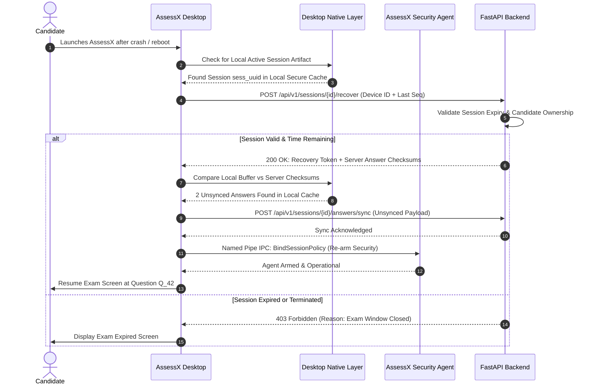

# ASSESSX — PHASE 3B SPECIFICATION
## Session Continuity, Answer Persistence & Recovery

**Project:** AssessX  
**Subphase:** Phase 3B of 4  
**Title:** Session Continuity, Answer Persistence & Recovery  
**Parent Document:** [Phase 3 Knowledge Base](file:///D:/AssessX-AI/AssessX-AI-main/docs/phases/PHASE-3-KNOWLEDGE-BASE.md)  
**Target Platform:** Windows 10 / Windows 11  
**Desktop Stack:** Tauri v2 + React 19 + TypeScript + Rust  
**Native Agent:** AssessX Security Agent (Rust, Named Pipe IPC `\\.\pipe\AssessXSecurityAgent`)  
**Backend:** FastAPI + SQLAlchemy + PostgreSQL (Supabase)  
**Document Type:** Detailed Engineering & Implementation Specification  
**Status:** Implementation Ready  

---

## 1. Objectives & Overview

Phase 3B delivers high-reliability **Answer Persistence, Real-Time Autosave, Network Tolerance, and Crash Recovery** for active examination sessions.

### Key Goals:
1. **Zero Data Loss Guarantee:** No candidate answer can be lost due to an application crash, Windows restart, network dropout, or hardware glitch.
2. **Deterministic Autosave Engine:** Every answer change, question transition, and section jump triggers an asynchronous, debounced persistence pipeline.
3. **Encrypted Local Buffer:** Answers are buffered locally in an encrypted store using Windows DPAPI / AES-256-GCM, preventing data loss during total offline periods while resisting candidate file tampering.
4. **Monotonic Revision Tracking:** Out-of-order or duplicate HTTP requests cannot overwrite newer answers or corrupt candidate submissions.
5. **Session Heartbeat & Interruption Detection:** Continuous telemetry between desktop, agent, and backend detects dropouts within 30 seconds and transitions the session to `INTERRUPTED`.
6. **Cryptographically Governed Crash Recovery:** Allows a candidate to resume an interrupted session seamlessly on the authorized device without bypassing time limits or examination rules.

---

## 2. Answer Persistence Architecture

```mermaid
flowchart TD
    A[Candidate Enters Answer / Selects Option] --> B{Trigger Type}
    B -->|Keystroke / Value Change| C[Debounced Autosave - 800ms]
    B -->|Question / Section Change| D[Immediate Flush]
    B -->|Explicit 'Save' Click| D
    
    C --> E[Assign Monotonic Client Revision]
    D --> E
    
    E --> F[Persist to Local Encrypted SQLite / DPAPI Buffer]
    F --> G[Queue in Synchronization Worker]
    
    G --> H{Network Available?}
    H -->|Yes| I[PUT /api/v1/sessions/{id}/answers/{qid}]
    H -->|No| J[Mark LOCAL_PENDING & Start Exponential Backoff]
    
    I --> K{Backend Acknowledged?}
    K -->|200 OK + Server Rev| L[Update Status: SYNCED in Memory & Local DB]
    K -->|Network / 5xx Error| J
    
    J --> M[Network Restored Event]
    M --> N[Drain Sync Queue in FIFO Order]
    N --> I
```

---

## 3. Monotonic Revision Tracking & Conflict Resolution

To avoid race conditions caused by delayed packets or duplicate network deliveries, each answer mutation is strictly versioned:

### Revision Schema:
- `client_revision`: Integer incremented monotonically by the client for each change to question $Q$.
- `server_revision`: Integer incremented by the backend upon successfully committing an answer.
- `idempotency_key`: UUID generated per discrete save operation to guarantee that duplicate transmissions do not create duplicate audit events.

### Backend Commit Rules:
1. When receiving an answer update with `client_revision`:
   - If `client_revision > last_committed_client_rev`: Accept and commit, increment `server_revision`, return `200 OK`.
   - If `client_revision <= last_committed_client_rev`: Stale update detected (network out-of-order delivery). Reject update, return current server state with `409 Conflict`.
2. Closed or Expired Session Protection:
   - If session status is `SUBMITTED`, `CLOSED`, or `EXPIRED`, reject any incoming answer mutations with `403 Forbidden`.

---

## 4. Local Encrypted Persistence (DPAPI / AES-256-GCM)

For offline resilience, answers must not be kept solely in volatile JavaScript memory.

1. **Storage Engine:**
   - Managed by the desktop native Rust layer via Tauri command: `save_answer_local`.
   - Stored in a session-scoped SQLite database or encrypted binary file located in the user's secure application data directory (`%APPDATA%\AssessX\sessions\<session_id>\answers.db`).
2. **Encryption:**
   - Keys are generated dynamically per session and protected using Windows **Data Protection API (`CryptProtectData`)**.
   - Answer payloads are encrypted with **AES-256-GCM** before touching disk.
   - Plaintext answer data is never exposed in flat temporary files or browser `localStorage`.
3. **Lifecycle & Cleanup:**
   - Upon successful final submission (Phase 3C) and verification by the server, the local encrypted buffer is securely wiped using zeroization (`ZeroMemory`).

---

## 5. Synchronization Worker & Network Tolerance

The synchronization engine operates as a resilient background worker in the React/TypeScript frontend with desktop Rust backing:

### Synchronization States:
- `SYNCED`: Answer committed to backend database. UI displays "All changes saved" (Green).
- `SYNCING`: Request in flight to server. UI displays "Saving..." (Blue spinner).
- `LOCAL_PENDING`: Saved locally to encrypted buffer, waiting for network. UI displays "Saved locally (Offline)" (Amber).
- `RETRY_PENDING`: Previous attempt failed; backoff timer running. UI displays "Retrying save..." (Amber).
- `FAILED`: Critical failure after maximum retries; UI displays alert to contact proctor.

### Retry Strategy:
- Exponential backoff with full jitter:
  $$T_{\text{wait}} = \min(T_{\text{max}}, T_{\text{base}} \times 2^{\text{attempt}}) \pm \text{jitter}$$
- Defaults: $T_{\text{base}} = 1.5\,\text{s}$, $T_{\text{max}} = 30\,\text{s}$, max retries = unlimited until session expires.
- Instant flush on browser `window.addEventListener('online')` and Tauri network state transitions.

---

## 6. Session Continuity & Periodic Heartbeats

To detect crashes and prevent stealth tampering, the desktop application and Security Agent emit continuous heartbeats:

### Telemetry Packet (Emitted every 20 seconds):
```json
{
  "session_id": "sess_uuid",
  "client_timestamp": "2026-11-09T14:20:00Z",
  "heartbeat_sequence": 142,
  "answered_questions_count": 24,
  "pending_sync_count": 0,
  "agent_healthy": true,
  "tamper_violations_count": 0,
  "current_question_id": "q_42"
}
```

### Server-Side Interruption Trigger:
- If no heartbeat is received for **60 seconds**, the backend marks the session state as `INTERRUPTED`.
- The institutional proctor dashboard flags the candidate as "Connection Lost".

---

## 7. Crash Recovery Handshake

When an application crashes or the system experiences a power loss during an active exam:



---

## 8. User Interface Components

Phase 3B adds real-time feedback components to the examination interface:

1. **`SyncStatusBadge.tsx`**:
   - Compact status indicator in the top navbar:
     - 🟢 *Saved* (Checkmark)
     - 🔵 *Saving...* (Animated spinner)
     - 🟡 *Saved Offline* (Cloud with slash)
     - 🔴 *Sync Error* (Retry button)
2. **`OfflineAlertBanner.tsx`**:
   - Non-intrusive warning appearing when offline $> 15$ seconds: *"Network connection lost. Your answers are being securely saved on this device and will sync automatically when reconnected."*
3. **`RecoveryPromptModal.tsx`**:
   - Modal displayed on launch if an interrupted session is detected: *"AssessX detected an incomplete examination session from 14:15. Restoring your workspace..."*
4. **`ProctorRecoveryPanel.tsx`**:
   - Component inside the proctor/admin dashboard listing disconnected candidates with one-click actions: "Grant 5-minute grace period" or "Authorize manual resume".

---

## 9. Backend API Specifications

### 9.1 Save Single Answer
- **Endpoint:** `PUT /api/v1/sessions/{session_id}/answers/{question_id}`
- **Headers:** `Authorization: Bearer <token>`, `X-Client-Revision: 4`
- **Request Body:**
```json
{
  "answer_payload": { "selected_option_id": "opt_c" },
  "client_timestamp": "2026-11-09T14:21:05Z",
  "idempotency_key": "idem_uuid_1234"
}
```
- **Response:**
```json
{
  "saved": true,
  "question_id": "q_42",
  "server_revision": 4,
  "synced_at": "2026-11-09T14:21:05.120Z"
}
```

### 9.2 Batch Sync Unsaved Answers
- **Endpoint:** `POST /api/v1/sessions/{session_id}/answers/sync`
- **Request Body:**
```json
{
  "items": [
    {
      "question_id": "q_10",
      "answer_payload": { "text": "def solve(): return 42" },
      "client_revision": 12,
      "idempotency_key": "idem_uuid_5678"
    }
  ]
}
```
- **Response:**
```json
{
  "synced_count": 1,
  "server_revisions": { "q_10": 12 }
}
```

### 9.3 Report Heartbeat
- **Endpoint:** `POST /api/v1/sessions/{session_id}/heartbeat`
- **Request Body:** (See JSON telemetry schema in Section 6)
- **Response:**
```json
{
  "status": "ACTIVE",
  "time_remaining_seconds": 6840,
  "server_time": "2026-11-09T14:21:20Z"
}
```

### 9.4 Crash Recovery Request
- **Endpoint:** `POST /api/v1/sessions/{session_id}/recover`
- **Request Body:**
```json
{
  "device_id": "device_hw_uuid",
  "interruption_reason": "UNEXPECTED_TERMINATION"
}
```
- **Response:**
```json
{
  "recovery_authorized": true,
  "session_id": "sess_uuid",
  "remaining_seconds": 6810,
  "last_synced_question_id": "q_42",
  "server_answer_checksums": { "q_1": "a1b2...", "q_2": "c3d4..." }
}
```

---

## 10. Database Schema Additions

```sql
-- Session Answers Table
CREATE TABLE IF NOT EXISTS session_answers (
    id UUID PRIMARY KEY DEFAULT gen_random_uuid(),
    session_id UUID NOT NULL REFERENCES examination_sessions(id) ON DELETE CASCADE,
    question_id UUID NOT NULL,
    answer_payload JSONB NOT NULL,
    client_revision INT NOT NULL DEFAULT 1,
    server_revision INT NOT NULL DEFAULT 1,
    idempotency_key VARCHAR(64) UNIQUE,
    synced_at TIMESTAMPTZ NOT NULL DEFAULT NOW(),
    CONSTRAINT uq_session_question UNIQUE (session_id, question_id)
);

-- Answer Revision Audit Trail (Immutable history)
CREATE TABLE IF NOT EXISTS answer_revisions (
    id UUID PRIMARY KEY DEFAULT gen_random_uuid(),
    session_id UUID NOT NULL REFERENCES examination_sessions(id) ON DELETE CASCADE,
    question_id UUID NOT NULL,
    answer_payload JSONB NOT NULL,
    revision_number INT NOT NULL,
    submitted_at TIMESTAMPTZ NOT NULL DEFAULT NOW()
);

-- Session Heartbeat Log
CREATE TABLE IF NOT EXISTS session_heartbeats (
    id UUID PRIMARY KEY DEFAULT gen_random_uuid(),
    session_id UUID NOT NULL REFERENCES examination_sessions(id) ON DELETE CASCADE,
    sequence_num INT NOT NULL,
    answered_count INT NOT NULL,
    agent_healthy BOOLEAN NOT NULL DEFAULT TRUE,
    client_timestamp TIMESTAMPTZ NOT NULL,
    recorded_at TIMESTAMPTZ NOT NULL DEFAULT NOW()
);
```

---

## 11. Verification & Acceptance Criteria

1. **Zero Keystroke Loss:** Simulating app termination (`taskkill /F`) immediately after entering an answer restores the answer upon relaunch.
2. **Offline Resilience:** Simulating network disconnection preserves answers in the encrypted local store and syncs them automatically when connectivity returns.
3. **Monotonic Ordering:** Sending an artificially delayed request with an older revision number is rejected with HTTP 409 and does not overwrite current state.
4. **Heartbeat Interruption:** Ceasing heartbeats for $>60$ seconds moves the backend session status from `ACTIVE` to `INTERRUPTED`.
5. **Cross-Device Recovery Prevention:** Attempting to recover a session using a different `device_id` without explicit administrator authorization is rejected with HTTP 403.
6. **Encrypted Local Cache:** Verified that local session database is encrypted with Windows DPAPI / AES-256 and unreadable in plaintext.

