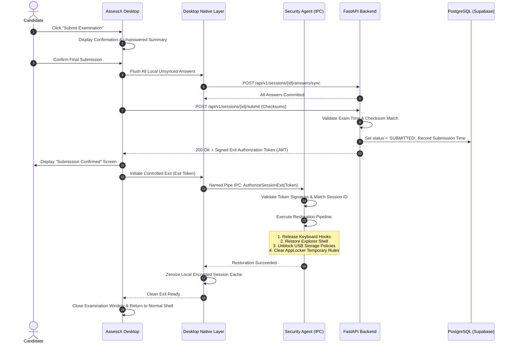

# ASSESSX — PHASE 3C SPECIFICATION
## Secure Exit, Completion & Institutional Administration

**Project:** AssessX  
**Subphase:** Phase 3C of 4  
**Title:** Secure Exit, Completion & Institutional Administration  
**Parent Document:** [Phase 3 Knowledge Base](file:///D:/AssessX-AI/AssessX-AI-main/docs/phases/PHASE-3-KNOWLEDGE-BASE.md)  
**Target Platform:** Windows 10 / Windows 11  
**Desktop Stack:** Tauri v2 + React 19 + TypeScript + Rust  
**Native Agent:** AssessX Security Agent (Rust, Named Pipe IPC `\\.\pipe\AssessXSecurityAgent`)  
**Backend:** FastAPI + SQLAlchemy + PostgreSQL (Supabase)  
**Document Type:** Detailed Engineering & Implementation Specification  
**Status:** Implementation Ready  

---

## 1. Objectives & Overview

Phase 3C completes the examination lifecycle by delivering **Authoritative Submission, Controlled Exit & System Restoration, and Centralized Institutional Administration**.

### Key Goals:
1. **Authoritative Submission:** Candidate submission requires complete answer synchronization, cryptographic session validation, and backend commit. The client cannot forge completion.
2. **Authoritative Expiry:** Examination expiration is enforced server-side. Local PC clock manipulation cannot grant extra time.
3. **Controlled Exit & System Restoration:** Closing the app or exiting kiosk mode requires a signed exit authorization token (from successful submission or proctor override). The Security Agent reliably restores the candidate's Windows environment to its original state.
4. **Emergency Recovery Route:** If hardware or network catastrophic failure occurs, administrators have a documented, auditable bypass key to restore normal Windows operation without stranding the computer.
5. **Institutional Admin Dashboard:** Centralized web/desktop portal for university administrators to monitor live exams, manage device fleets, approve recovery requests, and inspect audit logs.
6. **Remote Policy Management:** Create, version, approve, and distribute security policies across institutional exam machines without disruptive reboots during active exams.

---

## 2. Submission & Exit Workflow



---

## 3. Server-Authoritative Expiry & Anti-Tampering

1. **Server Expiry Authority:**
   - When the session is created in Phase 3A, the backend calculates and locks `expiry_time = start_time + duration_minutes + grace_period`.
   - The desktop client displays a countdown timer based on delta $(t_{\text{server\_expiry}} - t_{\text{now\_server}})$.
   - Changing the Windows system clock, timezone, or disabling Windows Time service has zero effect on backend acceptance.
2. **Auto-Submission Trigger:**
   - If the countdown reaches zero and the candidate has not clicked submit:
     1. The desktop application disables all question inputs immediately.
     2. An automatic flush of pending local answers is dispatched with flag `is_auto_submission: true`.
     3. Backend marks session status as `SUBMITTED (AUTO_EXPIRED)`.
     4. Exit authorization token is returned to the desktop.

---

## 4. Controlled Windows Environment Restoration

When an exit authorization is verified by the Security Agent:

### Multi-Step Restoration Sequence:
1. **Keyboard & Input Restoration:**
   - Unhooks `WH_KEYBOARD_LL` and unregisters raw input listeners.
   - Restores default processing for Alt+Tab, Windows Key, Ctrl+Esc, and accessibility keys.
2. **Windows Shell Restoration:**
   - If shell replacement was configured (`HKCU\Software\Microsoft\Windows NT\CurrentVersion\Winlogon\Shell`), reverts key back to `explorer.exe`.
   - Restarts Windows Explorer if terminated (`explorer.exe`).
3. **System Utilities Restoration:**
   - Deletes restriction keys under `HKCU\Software\Microsoft\Windows\CurrentVersion\Policies\System` (`DisableTaskMgr`, `DisableRegistryTools`).
   - Removes command prompt/PowerShell disable policies (`DisableCMD`).
4. **Peripheral & Storage Restoration:**
   - Removes `HKCU\Software\Policies\Microsoft\Windows\RemovableStorageDevices\Deny_All`.
   - Restores original USB mass storage accessibility.
5. **Local Artifact Zeroization:**
   - Wipes session encryption keys from memory.
   - Safely removes temporary SQLite databases and log caches.
6. **Restoration Verification & Audit Log:**
   - Verifies Task Manager, Explorer, and Hotkeys are responsive.
   - Emits an immutable audit event: `SYSTEM_RESTORATION_COMPLETED`.

---

## 5. Emergency Exit & Proctor Override

If the desktop application freezes or network connection cannot be restored:

1. **Proctor Master Override Hotkey:**
   - Accessible only via secure key combination (e.g., `Ctrl + Shift + Alt + F12`).
   - Opens an elevated authentication dialog.
2. **Offline Emergency Token Validation:**
   - The proctor enters an institutional Master Emergency PIN or scans an authenticator TOTP token generated by the institutional backend.
   - The Security Agent validates the PIN/TOTP locally using a cryptographic challenge hash pre-shared during device enrollment.
   - Triggers emergency restoration without needing active cloud connection.
   - Emits a high-priority audit event `EMERGENCY_PROCTOR_EXIT` with proctor ID and timestamp.

---

## 6. Institutional Administration Dashboard

Phase 3C extends the AssessX institutional admin portal (`/admin`) with dedicated lifecycle management modules:

```
┌────────────────────────────────────────────────────────────────────────┐
│ AssessX Institutional Administration Dashboard                         │
├─────────────────┬──────────────────────────────────────────────────────┤
│ 1. Overview     │ • Active Examinations: 4     • Active Candidates: 342│
│                 │ • Connected Devices: 350     • Interrupted: 3        │
├─────────────────┼──────────────────────────────────────────────────────┤
│ 2. Live Monitor │ [Candidate]   [Exam]     [Status]    [Sync]   [Action│
│                 │  John Doe     CS101       ACTIVE      🟢 100%  [View] │
│                 │  Jane Smith   MATH201    INTERRUPTED 🟡 2 min [Resume│
├─────────────────┼──────────────────────────────────────────────────────┤
│ 3. Device Fleet │ • Enrolled Laptops: 280   • Lab Desktops: 70         │
│                 │ • Agent Health: 99.4%     • Revoked: 1               │
├─────────────────┼──────────────────────────────────────────────────────┤
│ 4. Policies     │ • Active Policy: Strict-Exam-v3.2                     │
│                 │ • Pending Deployments: 0   [Create New Policy]       │
├─────────────────┼──────────────────────────────────────────────────────┤
│ 5. Audit Trail  │ [14:22:01] Candidate John Doe: Exam Started (Device 14│
│                 │ [14:23:45] Proctor Smith: Recovery Authorized (Sess 9│
└─────────────────┴──────────────────────────────────────────────────────┘
```

### Dashboard Core Capabilities:
- **Live Candidate Monitor:** Real-time table of candidates, remaining time, answers synced, heartbeat ping, and risk scores.
- **Interruption Resolution:** One-click approval to authorize resume for candidates suffering power or system crashes.
- **Device Management:** Whitelist or revoke device hardware IDs; trigger remote diagnostic scans.
- **Security Audit Log:** Filterable, exportable (CSV/JSON) immutable log of all lifecycle events.

---

## 7. Remote Security Policy Management

Allows institutions to define tailored security profiles for different types of assessments (e.g., "Open Book Programming Exam" vs. "Strict Closed Book Exam"):

### Policy Schema Components:
- `policy_id`: UUID
- `version`: Monotonic integer
- `allowlisted_binaries`: Array of permitted executables (e.g., `["assessx.exe", "code.exe"]`)
- `block_usb_storage`: Boolean (default: true)
- `max_monitors`: Integer (default: 1)
- `disallow_task_manager`: Boolean (default: true)
- `enforce_kiosk_shell`: Boolean (default: true)
- `allow_network_calculator`: Boolean (default: false)

### Safe Deployment Protocol:
- Policies are drafted, signed with the institution's private key, and published to the fleet.
- **Active Exam Protection:** A policy update is never applied to a machine currently running an `ACTIVE` session. Deployments queue until the active session enters `CLOSED`.

---

## 8. Backend API Specifications

### 8.1 Submit Examination
- **Endpoint:** `POST /api/v1/sessions/{session_id}/submit`
- **Request Body:**
```json
{
  "device_id": "device_hw_uuid",
  "client_submit_time": "2026-11-09T14:30:00Z",
  "total_answered": 45,
  "answer_checksum": "sha256_hash_of_answers"
}
```
- **Response:**
```json
{
  "submitted": true,
  "submission_id": "sub_uuid",
  "exit_authorization_token": "eyJhbGciOi...",
  "submitted_at": "2026-11-09T14:30:01.050Z"
}
```

### 8.2 Request Proctor Emergency Exit
- **Endpoint:** `POST /api/v1/sessions/{session_id}/emergency-exit`
- **Request Body:**
```json
{
  "proctor_username": "proctor_smith",
  "proctor_password": "...",
  "reason": "MEDICAL_EMERGENCY"
}
```
- **Response:**
```json
{
  "exit_authorized": true,
  "exit_token": "eyJhbGciOi...",
  "audit_event_id": "evt_uuid"
}
```

### 8.3 Institutional Dashboard Overview
- **Endpoint:** `GET /api/v1/institutions/{institution_id}/dashboard-stats`
- **Response:**
```json
{
  "active_sessions_count": 342,
  "interrupted_sessions_count": 3,
  "completed_today": 128,
  "active_devices_count": 350,
  "recent_alerts": []
}
```

---

## 9. Database Schema Additions

```sql
-- Examination Submissions Table
CREATE TABLE IF NOT EXISTS examination_submissions (
    id UUID PRIMARY KEY DEFAULT gen_random_uuid(),
    session_id UUID NOT NULL REFERENCES examination_sessions(id) ON DELETE RESTRICT,
    exam_id UUID NOT NULL REFERENCES assessments(id) ON DELETE RESTRICT,
    candidate_id UUID NOT NULL REFERENCES profiles(id) ON DELETE RESTRICT,
    total_answered INT NOT NULL,
    total_questions INT NOT NULL,
    answer_checksum VARCHAR(64) NOT NULL,
    is_auto_submitted BOOLEAN NOT NULL DEFAULT FALSE,
    submitted_at TIMESTAMPTZ NOT NULL DEFAULT NOW()
);

-- Exit Authorizations Table
CREATE TABLE IF NOT EXISTS exit_authorizations (
    id UUID PRIMARY KEY DEFAULT gen_random_uuid(),
    session_id UUID NOT NULL REFERENCES examination_sessions(id) ON DELETE CASCADE,
    exit_type VARCHAR(32) NOT NULL, -- 'NORMAL_SUBMISSION', 'TIME_EXPIRED', 'PROCTOR_EMERGENCY'
    authorized_by UUID, -- Proctor profile ID if emergency
    exit_token_hash VARCHAR(128) NOT NULL,
    restoration_confirmed BOOLEAN NOT NULL DEFAULT FALSE,
    created_at TIMESTAMPTZ NOT NULL DEFAULT NOW()
);

-- Institutional Policies Table
CREATE TABLE IF NOT EXISTS institution_policies (
    id UUID PRIMARY KEY DEFAULT gen_random_uuid(),
    institution_id UUID NOT NULL REFERENCES institutions(id) ON DELETE CASCADE,
    name VARCHAR(128) NOT NULL,
    version INT NOT NULL DEFAULT 1,
    configuration JSONB NOT NULL,
    is_active BOOLEAN NOT NULL DEFAULT TRUE,
    created_at TIMESTAMPTZ NOT NULL DEFAULT NOW(),
    updated_at TIMESTAMPTZ NOT NULL DEFAULT NOW()
);
```

---

## 10. Verification & Acceptance Criteria

1. **Submission Irreversibility:** Once submitted, no further answer updates can be made by the candidate.
2. **Zero Stranded Computers:** Calling the exit restoration sequence restores Task Manager, Explorer, and default keyboard shortcuts 100% of the time.
3. **Emergency Proctor Exit:** In simulated total offline mode, proctor emergency bypass PIN releases the lockdown cleanly.
4. **Clock Manipulation Immunity:** Setting the local Windows system clock backward does not extend the server-enforced expiration time.
5. **Non-Disruptive Policy Updates:** Pushing a new institutional policy does not restart or disrupt currently running exams.
6. **Full Lifecycle Completeness:** A candidate can move from Login $\to$ Eligibility $\to$ Readiness $\to$ Active Exam $\to$ Autosave $\to$ Submission $\to$ Clean Restoration seamlessly.

